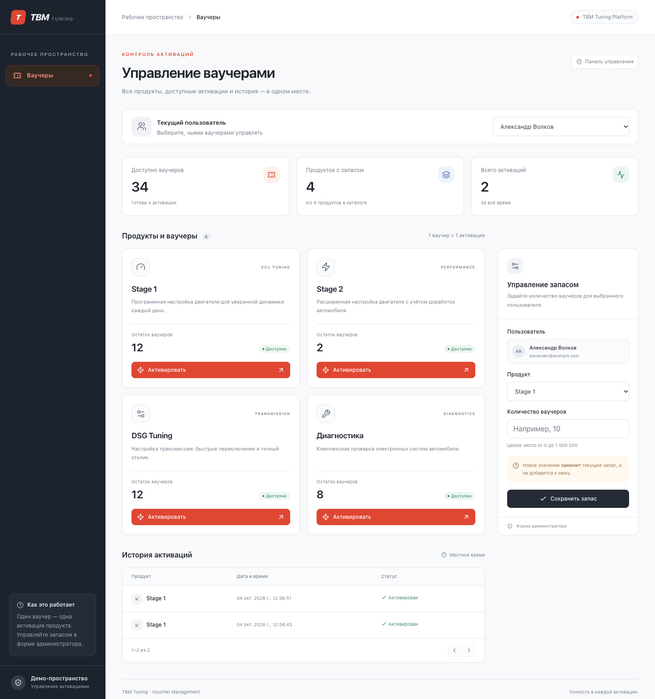

# TBM Tuning — управление ваучерами

Тестовое задание Full Stack Engineer: Rust + Axum + sqlx + PostgreSQL; React + TypeScript + shadcn/ui.



## Запуск одной командой

Нужны Docker Engine / Docker Desktop с Docker Compose v2 и свободный порт 8080.

```sh
docker compose up --build -d --wait
```

Откройте **http://localhost:8080**. Миграции и начальные данные применяются автоматически. Локальные Rust, Node.js и PostgreSQL не нужны. Первая сборка скачивает образы и компилирует Rust, поэтому может занять несколько минут.

Другой порт: `PORT=8081 docker compose up --build -d --wait`.

```sh
docker compose logs -f backend # логи API
docker compose down            # остановить, сохранив данные
```

Для полного сброса демоданных: `docker compose down -v` (удалит данные проекта), затем повторите команду запуска.

## Что проверить

1. Выберите пользователя. Для Александра в начальных данных есть 5 ваучеров Stage 1, 2 Stage 2, 0 DSG Tuning и 8 на диагностику.
2. Нажмите «Активировать»: запас уменьшится на один, в истории появятся продукт и время активации.
3. У продукта с нулевым запасом кнопка отключена. Если запас закончился в другой вкладке, API вернёт `409`, интерфейс покажет сообщение и обновит данные.
4. В форме администратора выберите продукт и задайте целое количество от 0 до 1 000 000. Это **замена** запаса, а не прибавление.
5. Переключите пользователя: его остатки и история независимы. История отображается по 5 записей, новые сверху; время показано в локальном часовом поясе браузера.

Все требования реализованы: выбор пользователя, остатки и активация, история, форма администратора, состояния загрузки/ошибок. Дополнительно: backend-тесты, OpenAPI и типизированный клиент из схемы, браузерные тесты, шаблон CI и адаптивная вёрстка.

## Проверки

Backend: интеграционные HTTP-тесты с настоящим PostgreSQL, каждый в отдельной тестовой базе:

```sh
docker compose --profile test run --build --rm test
```

Проверяются успешная активация, отсутствие ваучеров, установка и валидация запаса, неизвестные пользователи/продукты, изоляция истории и пагинация, 20 конкурентных запросов на последний ваучер, откат транзакции при ошибке записи истории.

Форматирование и статический анализ Rust:

```sh
docker compose --profile test run --rm --no-deps test cargo fmt --check
docker compose --profile test run --rm --no-deps test cargo clippy --locked --all-targets -- -D warnings
```

Frontend (Node.js 22+, приложение запущено):

```sh
cd frontend
npm ci
npm run build
npx playwright install --with-deps chromium
npx playwright test
```

Для уже установленного Google Chrome: `PLAYWRIGHT_CHANNEL=chrome npx playwright test`. Браузерные тесты меняют демоданные Данияра; используйте отдельный экземпляр для тестирования, если важно сохранить демонстрационные остатки.

Шаблон [GitHub Actions](.github/ci.example.yml) запускает backend-тесты, форматирование, Clippy, сверку генерации OpenAPI, сборку Compose и браузерные сценарии. Для включения поместите его в `.github/workflows/ci.yml` через GitHub или подключение с разрешением `workflow`. В текущем репозитории автоматический запуск CI не включён; проверки выполнены локально.

## API и генерация клиента

Схема генерируется непосредственно из Rust-моделей и обработчиков через `utoipa`:

- Во время работы: http://localhost:8080/api/openapi.json
- В репозитории: [`openapi.json`](openapi.json)
- Сгенерированные TypeScript-типы: [`frontend/src/lib/api-schema.d.ts`](frontend/src/lib/api-schema.d.ts)
- Клиент `openapi-fetch` использует эти типы для проверки маршрутов, параметров, запросов и ответов; модели вручную не дублируются.

Перегенерация (Docker и Node.js 22+):

```sh
./scripts/generate-api.sh
```

| Метод | Путь                                            | Назначение                                |
| ----- | ----------------------------------------------- | ----------------------------------------- |
| GET   | `/api/users`                                    | Пользователи                              |
| GET   | `/api/products`                                 | Продукты                                  |
| GET   | `/api/users/{id}/balances`                      | Все продукты с остатками, включая нулевые |
| PUT   | `/api/users/{id}/balances/{product_id}`         | Заменить запас: `{"quantity": 5}`         |
| POST  | `/api/users/{id}/activations/{product_id}`      | Списать ваучер и записать активацию       |
| GET   | `/api/users/{id}/activations?limit=20&offset=0` | История с общим количеством               |
| GET   | `/api/health`                                   | Проверка доступности API и БД             |

Доменная ошибка: `{"code":"no_vouchers","message":"…"}`. Основные статусы: `201` — активация, `400` — неверное количество/пагинация, `404` — нет сущности, `409` — нет ваучеров, `500` — внутренняя ошибка. Технические сведения о БД остаются в логах. Ошибки разбора URL-параметров возвращает Axum (`400`).

## Почему так устроено

- **Атомарная активация.** В транзакции выполняется `UPDATE … SET quantity = quantity - 1 WHERE quantity > 0`. PostgreSQL блокирует строку и повторно проверяет условие после конкурирующего обновления. Если обновлено 0 строк — `409`. Затем в той же транзакции записывается история: либо оба изменения фиксируются, либо оба отменяются. Ограничение `CHECK` дополнительно запрещает отрицательный запас.
- **Установка запаса.** `INSERT … ON CONFLICT DO UPDATE` создаёт отсутствующий остаток или заменяет существующий. Административное изменение и активация сериализуются блокировкой одной строки; результат зависит от порядка выполнения операций. Это намеренная семантика абсолютного значения.
- **История.** Индекс `(user_id, activated_at DESC, id DESC)`, лимит до 100 записей, стабильный порядок по времени и ID. Строки страницы и общее количество читаются в одном snapshot (`REPEATABLE READ`). Offset-пагинация проста для размера задания; при новых записях между переходами страницы могут смещаться.
- **Frontend.** TanStack Query хранит данные отдельно для каждого пользователя. После записи кэш остатков и истории инвалидируется; переключение пользователя отменяет старые запросы и сбрасывает локальное состояние формы. Повторная отправка мутаций автоматически не выполняется.
- **Развёртывание.** Nginx раздаёт frontend и проксирует `/api` в Axum. Один origin, CORS не требуется. PostgreSQL и backend не публикуют порты наружу; UI доступен на localhost. Миграции встроены в бинарник, данные — в Docker volume; зависимости закреплены lock-файлами.
- **Границы задания.** Авторизации и CRUD пользователей/продуктов нет по ТЗ. Учётные данные БД — только для локальной демонстрации. Перед реальным использованием нужны авторизация и роли, управление секретами, аудит администратора и ключ идемпотентности для повторов активации после сетевого сбоя.

## Структура

```text
backend/src/           Axum API, модели, ошибки, экспорт OpenAPI
backend/migrations/    схема PostgreSQL и демоданные
backend/tests/         интеграционные тесты
frontend/src/          React-интерфейс и shadcn/ui-компоненты
frontend/e2e/          Playwright-сценарии
scripts/               генерация API
compose.yaml           запуск и профиль тестирования
.github/ci.example.yml шаблон CI
```
